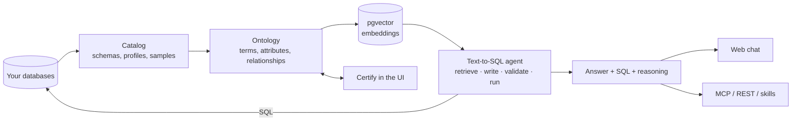

<!--
SPDX-FileCopyrightText: Copyright (c) 2026, NVIDIA CORPORATION & AFFILIATES.
SPDX-FileCopyrightText: Copyright (c) 2026, Julien Awonga.
SPDX-License-Identifier: Apache-2.0
-->

<div align="center">


# Lexis

### Ask your database anything, and get an answer you can check.

Lexis reads your schemas, builds a **business ontology** on top of them, and lets people and AI agents
query your data in plain language, with the SQL, the steps and the definitions behind every answer.

[](https://github.com/julienawonga/lexis/actions/workflows/ci-python.yml)
[](https://github.com/julienawonga/lexis/actions/workflows/ci-client.yml)
[](./LICENSE)

[**Quick start**](#-quick-start) · [**Features**](#-features) · [**How it works**](#%EF%B8%8F-how-it-works) ·
[**Agents & MCP**](#-use-it-from-your-agent) · [**Roadmap**](#%EF%B8%8F-roadmap) · [**Docs**](#-documentation)


</div>

---

## 💡 Why Lexis?

Text-to-SQL demos look great until the number is wrong. A revenue figure answered in two seconds is worth nothing if
nobody can tell **which tables it joined, which definition of "revenue" it used, or whether that definition is the
one finance agreed on**. Lexis puts a **semantic layer** between your questions and your databases:

- 🧠 **It understands your data.** It profiles every table and column, then compiles business **Terms**
  (*Customer*, *Payment*, *Store*), their attributes and relationships into an ontology stored next to your catalog.
- 🔍 **It shows its work.** Every answer comes with the generated SQL, the reasoning, the database it used and the
  terms it resolved.
- ✅ **It uses your definitions.** Certify a metric once ("revenue per store = payments → rentals → inventory store")
  and the agent applies it whenever someone asks.
- 🤖 **It speaks to your agents.** The same ontology is served over **MCP**, a **REST API** and agent skills.

Bring **any OpenAI-compatible model** and **any of ten SQL engines**; everything runs on your own infrastructure.

## ✨ Features

| | |
|---|---|
| 💬 **Chat with your data** | Ask in any language. Answers stream in with a chart or a table, the SQL and reasoning behind a toggle, and a plain note when a result was cut or came back empty. |
| 🧩 **Auto-built ontology** | Semantic compilation turns raw schemas into Terms, attributes and relationships, embedded in pgvector for retrieval. |
| 🕸️ **Ontology explorer** | An interactive graph of terms and data objects, grouped by business domain. |
| ✅ **Certified analyses** | Reference SQL for key business questions, suggested in the chat and reused by the agent. |
| 🛡️ **Governance** | Users, groups, roles, zones, tags, PII detection, SSO, API tokens and an admin audit log. |
| 🐳 **Self-hosted** | Docker Compose for a laptop, a Helm chart for Kubernetes. Your data stays on your infrastructure. |

<table>
  <tr>
    <td width="50%"><p align="center"><b>Chat</b>: answer, SQL and chart</p></td>
    <td width="50%"><p align="center"><b>Terms</b>: the ontology, term by term</p></td>
  </tr>
  <tr>
    <td width="50%"><p align="center"><b>Exploration</b>: the ontology as a graph</p></td>
    <td width="50%"><p align="center"><b>Analytics</b>: every question, audited</p></td>
  </tr>
</table>

## 🚀 Quick start

You need **Docker** (Compose v2) and an API key for any **OpenAI-compatible** model endpoint. This walkthrough uses
**Pagila**, a sample DVD-rental database shipped with the repository.

**1. Clone and configure**

```bash
git clone https://github.com/julienawonga/lexis.git auto-ontology && cd auto-ontology
cp .env.example .env
```

Edit `.env` and set at least:

```dotenv
DEFAULT_MODELS_ENDPOINT=https://your-endpoint/v1      # any OpenAI-compatible endpoint
DEFAULT_MODELS_API_KEY=sk-...
DEFAULT_MODELS_MODEL=openai/gpt-4.1                   # any OpenAI-compatible model name
EMBED_MODEL=text-embedding-3-small
EMBED_DIMENSIONS=1536                                 # the output width of your embedding model
EMBED_EXTRA_FIELDS=false
AUTH_SECRET=<output of: openssl rand -base64 32>
INTERNAL_API_TOKEN=<output of: openssl rand -hex 32>
POSTGRES_PASSWORD=<a new password>
AUTO_ONTOLOGY_ADMIN_PASSWORD=<a new password>
```

Embeddings use the chat model's endpoint and key unless you set `EMBED_ENDPOINT` and `EMBED_API_KEY`. If the first
build runs out of memory, build the images one at a time: `docker compose build auto-ontology`, then
`docker compose build auto-ontology-frontend`.

**2. Start the stack and load the sample data**

```bash
docker compose up -d --wait postgres
docker exec -i postgres psql -U postgres -c "CREATE DATABASE pagila;"
docker exec -i postgres psql -U postgres -d pagila < dev_tools/fixtures/sql/pagila.sql
docker compose up -d --build
```

**3. Connect, compile, ask**

1. Open <http://localhost:3000> and sign in with `AUTO_ONTOLOGY_ADMIN_EMAIL` / `AUTO_ONTOLOGY_ADMIN_PASSWORD`.
2. **Settings → Connections**: add PostgreSQL, host `postgres`, database `pagila`, and tick **Exclude Views**.
3. **Settings → Semantic Compilation**: turn it on and wait for *Semantic compilation is ready*.
4. Ask in **Chat**: *"What is the revenue per store?"* or *"Which 5 films made the most money?"*

Kubernetes: see [DEPLOYMENT.md](./DEPLOYMENT.md). Models and embeddings: [docs/configuration.md](./docs/configuration.md).
Backups and rollback: [docs/backup-restore.md](./docs/backup-restore.md).

## 🔌 Works with

**Databases**: PostgreSQL · MySQL · Snowflake · Databricks · ClickHouse · Trino · Apache Kyuubi · HeavyDB · DuckDB ·
SQLite ([connection guide](./docs/connections.md)). **Models**: anything that speaks the OpenAI API, such as OpenAI,
Azure OpenAI, LiteLLM, Ollama, vLLM or LM Studio. **Agents**: Claude Desktop, Claude Code, Cursor, any MCP client,
REST, agent skills. **Semantic models**: import and export with [Apache Ossie](https://ossie.apache.org/).

## 🏗️ How it works



1. **Compile.** The ingestion service extracts schemas, profiles columns and samples values; an LLM names the business
   entities, maps them to columns and infers how tables join.
2. **Certify.** People review terms, descriptions and SQL attributes in the UI and certify the right ones.
3. **Answer.** For each question the agent retrieves candidate terms and columns by embedding search, writes SQL,
   checks it against the database (repairing it when a check fails), runs it read-only with a row cap, and returns the
   answer with its SQL and steps.

Components: web app (Next.js 16, port 3000), API (FastAPI, 3001), ingestion and compilation (FastAPI, 3002), MCP
server (3003), PostgreSQL 17 with pgvector.

> [!IMPORTANT]
> Keep ports 3001 and 3002 on a private network: the API trusts the user identity the web app forwards. Docker Compose
> publishes the API, the ingestion service, PostgreSQL and pgAdmin on `127.0.0.1` only (`BIND_ADDRESS` in `.env`
> changes that on purpose). Also set `INTERNAL_API_TOKEN` (the same value for the web app, the API and the ingestion
> service) so they refuse requests that lack it; see [SECURITY.md](SECURITY.md#internal-api-token).

## 🤖 Use it from your agent

**MCP.** Any MCP client gets read-only tools over the ontology (`search_terms`, `get_term`, `check_answerable`,
`ask_question`…), with each user's own permissions: `{"mcpServers": {"auto-ontology": {"url": "http://localhost:3003/mcp"}}}`.

**REST.** Create an API token from the account menu, then stream an answer:

```bash
curl -N http://localhost:3000/api/chat/completions \
  -H "x-api-key: $AUTO_ONTOLOGY_API_TOKEN" -H "Content-Type: application/json" \
  -d '{"question": "What is the revenue per store?"}'
```

**Agent skills.** Three skills teach a coding agent to set up, manage and query an ontology; start at
[AGENTS.md](./AGENTS.md). Details: [docs/mcp.md](./docs/mcp.md), [docs/conversation-api.md](./docs/conversation-api.md).

## 🗺️ Roadmap

Everything has so far been tried on public or invented test databases, not on a company's own data;
[docs/verification-status.md](./docs/verification-status.md) says, feature by feature, what was checked and how, and
[docs/experiments.md](./docs/experiments.md) logs every measurement, failures included.

**Available today.** Questions in any language with the SQL, the database used and a plain note when a result is cut
or empty. Business Terms and metrics, certified on the Terms page or through the API and given to the model. An
exploration map by database and business domain. Agent SQL that is read-only and row-capped, enforced by the database
on six engines. Limits on concurrent chats and model calls, health checks, clear JSON errors, an admin audit log, an
internal API token, and a backup and restore guide. Evaluation tooling: frozen question sets on three databases
(Chinook, Pagila, an invented rental company), unanswerable questions, a conversation-aware protocol, paired
statistics and a regression history.

**Works, with limits.** Matching typed values to stored ones ("USA" for "United States"), tried on one database.
Clarification questions when a term is unknown (off by default; the wording of the options varies). Learned terms: a
clarification answer can become a personal draft, reviewed on a page by an owner; off by default, and the chat does not
use drafts yet.

**Written, waiting for their evaluation** (behind flags, off, not merged). Refusing questions the data cannot answer:
a first version refused every unanswerable question but also answerable ones and was rejected, a second is written and
not yet measured. Excluding soft-deleted rows by default, the main weakness measured on an invented database (about 44%
there). A record of which knowledge the model says it applied. A shared semantic contract (parked).

**Next, in this order.**
5. Business metrics people can trust and reuse.
6. Your own questions and databases: this needs your questions; until then every result comes from test data.
7. A reliable mark of which definitions, columns and values each answer used.
8. Learned terms used by the chat, with who said it and when.
9. Approval that writes a draft into the ontology, with a diff, history and rollback.
10. Team features beyond the audit log: retention, per-zone views.
11. Database-enforced read-only on Databricks, Kyuubi and HeavyDB (Snowflake has an optional role; none of the four
    engines could be tried).
12. Quality checks in CI with a recorded model (the mechanism is built, no recording yet).

**Later.** Moving Terms between domains in the interface · values in several languages · verified queries reused with
parameters · suggestions mined from query history · duplicate detection · per-question trace of repairs, time and cost ·
a scheduled evaluation per customer database · per-user database credentials and row-level security · model-spend budgets
per user · export and import of the ontology between environments · interface translations (French first) · one-click
deploy templates.

**Tried and not merged.** Repairing literal values in the SQL engine, a certified metric forced into the table list and
a model's own "partly answered" flag: none beat the current engine ([docs/experiments.md](./docs/experiments.md), E26,
E27, E28).

## 🤝 Contributing

Contributions are welcome, from typo fixes to new connectors. Read [CONTRIBUTING.md](./CONTRIBUTING.md), then open a
pull request: CI runs Ruff, pytest, Prettier, ESLint, the frontend build and the OpenAPI checks on every PR.

## 📚 Documentation

The [published documentation](https://julienawonga.github.io/lexis/); preview it with
`uvx --with "mkdocs-material~=9.6" mkdocs serve`.

| Topic | Doc |
|---|---|
| Models, embeddings and environment variables | [docs/configuration.md](./docs/configuration.md) |
| Connections, scoping and Vault | [docs/connections.md](./docs/connections.md) |
| Authentication, SSO, API tokens and the audit log | [docs/authentication.md](./docs/authentication.md), [docs/audit-log.md](./docs/audit-log.md) |
| Conversation API | [docs/conversation-api.md](./docs/conversation-api.md) |
| Safety of agent-issued SQL | [docs/query-safety.md](./docs/query-safety.md) |
| Evaluating the text-to-SQL engine | [docs/evaluation.md](./docs/evaluation.md) |
| What is verified for real, and what is not | [docs/verification-status.md](./docs/verification-status.md) |
| MCP server | [docs/mcp.md](./docs/mcp.md) |
| Backup, restore and rollback | [docs/backup-restore.md](./docs/backup-restore.md) |
| Kubernetes with Helm | [DEPLOYMENT.md](./DEPLOYMENT.md) |
| REST API (OpenAPI) | [docs/openapi/auto-ontology-api.json](./docs/openapi/auto-ontology-api.json) |
| What this fork changed | [FORK.md](./FORK.md) |

## 📄 License and credits

Lexis is licensed under the [Apache License 2.0](./LICENSE). It started as a fork of
[NVIDIA/auto-ontology](https://github.com/NVIDIA/auto-ontology); files from the original project keep their copyright
headers, as the license requires. Third-party components are listed in [THIRD_PARTY_NOTICES.md](./THIRD_PARTY_NOTICES.md)
and [CONTAINER_THIRD_PARTY_NOTICES.md](./CONTAINER_THIRD_PARTY_NOTICES.md).

This software calls the model endpoints you configure, the optional KumoRFM service when `KUMO_RFM_API_KEY` is set, and
your own databases, each under its own terms. It is provided "as is", without warranty of any kind. Report security
issues as described in [SECURITY.md](./SECURITY.md).
